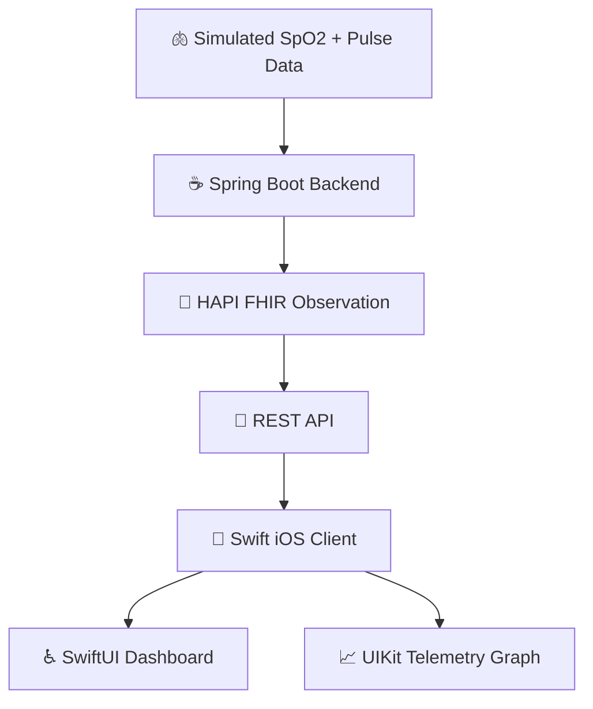

# Respiro

FHIR Vitals Monitor

## What's going on here

Respiro is an iPhone app that shows your oxygen level and pulse in real time. Many people check these at home with a small finger clip called a pulse oximeter. But the readings often stay trapped inside each device's own app. Respiro keeps the data in FHIR, which is the standard format healthcare systems use, so it can be shared and understood by other tools.

The goal is simple. Make pulmonary data easy to read, easy to share, and easier to understand.

- A Java backend creates simulated oxygen (SpO2) and pulse readings
- It serves them as standard FHIR data
- A Swift iPhone app reads them and shows a live dashboard
- Everything runs on made-up data, with no real device or patient involved

## How it fits together



## What the backend does

- Makes a new simulated reading every 3 seconds
- Saves each reading in an in-memory database, so a restart clears them
- Wraps each reading in FHIR `Observation`s using HAPI FHIR
- Serves the readings over a REST API
- Pushes new readings to the app the moment they happen, using Server-Sent Events
- Can require an API key and limit which websites can call it

## What the iPhone app does

- Shows your current oxygen level and pulse
- Draws a live graph of both over time
- Marks an oxygen level below 90% as low
- Has accessibility labels, so VoiceOver can read the dashboard out loud
- Uses SwiftUI for the screens and UIKit for the fast, real-time graph

## Tech stack

- **Backend:** Java, Spring Boot, REST, and HAPI FHIR
- **App:** Swift, SwiftUI, and UIKit
- **Testing:** JUnit and XCTest
- **Packaging and CI:** Docker and GitHub Actions
- **Planned, not built yet:** deploying to AWS (ECR, ECS, and IAM)

## Getting started

### Backend

You'll need Java and Maven. Then do this.

```bash
cd backend
mvn spring-boot:run
```

It starts on `http://localhost:8080` and begins making readings right away. Here's what you can ask it for.

- `GET /api/vitals/latest` gives the most recent reading, as a FHIR `Bundle` of `Observation`s
- `GET /api/vitals/history?limit=50` gives recent readings (1 to 50), in the same shape
- `GET /api/vitals/stream` streams new readings as they're generated
- `GET /actuator/health` is the health check

Some extras:

- Run the tests with `mvn test`
- Build the container with `docker build -t respiro-backend backend`
- By default, the API is open and any website can call it, which is fine for local work
- Set `app.api-key` (or the `APP_API_KEY` environment variable) to require an `X-API-Key` header on `/api/**` requests
- Set `app.cors.allowed-origins` to limit which websites can call it from a browser

### iOS app

The models, networking, view model, and screens live in `ios/Sources/Respiro/` as a Swift package. The tests are in `ios/Tests/RespiroTests/`. You can run those without Xcode.

```bash
cd ios
swift test
```

The app's starting point is `ios/Respiro/App/RespiroApp.swift`. It needs Xcode on a Mac, because that's what turns the package into an app you can install.

- Create a new iOS App project in Xcode, with a SwiftUI interface
- Add `ios/` as a local Swift package (File → Add Package Dependencies → Add Local)
- Add `Respiro` to the app target
- Add `ios/Respiro/App/RespiroApp.swift` to the app target, in place of the one Xcode makes
- On a real iPhone, change `RespiroApp.backendURL` to your Mac's address on your network, since `localhost` on a phone means the phone itself
- If the backend has an API key, pass it to `VitalsViewModel(baseURL:apiKey:)` in `RespiroApp`
- Start the backend first, then build and run the app

## Good to know

- The Swift package tests cover turning FHIR data into readings and flagging low oxygen
- The backend has tests for the API, the FHIR mapping, the simulated data, and the API key check
- GitHub Actions runs the backend tests on every change
- The Docker image is built locally and isn't published anywhere yet
